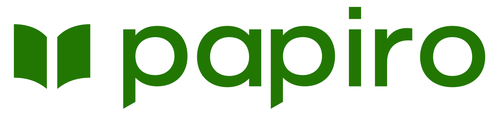

# papiro — identidade visual

**Miolo** é a identidade do papiro. Os arquivos canônicos estão neste
diretório, com o desenho e a composição exatos da versão adotada.

## Arquivos

| Arquivo | Uso |
| --- | --- |
| [papiro.svg](papiro.svg) | Assinatura oliva para fundos claros |
| [papiro-reverse.svg](papiro-reverse.svg) | Assinatura clara para fundos escuros |
| [papiro-mono.svg](papiro-mono.svg) | Assinatura preta em uma cor |
| [papiro-mark.svg](papiro-mark.svg) | Símbolo oliva |
| [papiro-mark-reverse.svg](papiro-mark-reverse.svg) | Símbolo claro |
| [papiro-mark-mono.svg](papiro-mark-mono.svg) | Símbolo preto em uma cor |
| [papiro.png](papiro.png) | Assinatura transparente, 1200 × 279 px |
| [papiro-mark.png](papiro-mark.png) | Símbolo transparente, 416 × 416 px |

Os SVGs têm fundo transparente, geometria editável, letras em contornos e
nenhuma dependência de fontes ou recursos externos. A cor é definida por
`color` na raiz e aplicada por `currentColor`. Assinatura: `viewBox` de
568 × 132; símbolo: 104 × 104. Preservar a proporção e todo o respiro dessas
caixas. Os PNGs são exportações RGBA transparentes dos SVGs canônicos via
`rsvg-convert` (larguras de 1200 e 416 px).

## Desenho e procedência

Dois planos sólidos com bordas curvas formam um livro aberto. O intervalo
central de 12 unidades mantém a abertura visível em redução. O lettering
geométrico original vem integralmente da proposta
[01 — Nome](studies/2026-11-26/01-nome/papiro.svg), sem substituição por fonte.

A versão adotada aparece na terceira coluna da
[prancha da rodada 03](studies/2026-11-26-round-03-recraft/comparison.png).
Seu símbolo foi desenhado localmente na
[rodada 02](studies/2026-11-26-round-02/03-miolo/papiro.svg) e reapresentado
sem alterações na rodada 03. Nesta adoção foram alterados apenas título e
descrição acessíveis dos SVGs canônicos; toda a geometria, composição e cor
foram preservadas.

| Cor | Hex | Origem |
| --- | --- | --- |
| Oliva | `#227702` | Conversão sRGB de `accent` claro / `olive-600`, `oklch(0.5 0.16 140)` |
| Claro | `#eaece6` | Conversão sRGB de `ink` escuro, `oklch(0.94 0.008 120)` |
| Preto | `#000000` | Reprodução monocromática |

A cor da marca deriva dos tokens do site e é re-derivada quando eles mudam;
a geometria permanece fixa. A oliva vigorosa acompanha o propósito da paleta:
manter o concurseiro alerta durante o estudo. O `accent` do tema escuro do
site converte para `#68d54e` (`oklch(0.78 0.2 140)`) — não é cor dos ativos
canônicos; em fundos escuros usa-se a versão clara (reverse). Medido em
sRGB, o contraste da oliva sobre o papel claro é de 5,3:1 e o do claro
sobre o papel escuro é de 15,4:1.

As pranchas históricas dos estudos usam papel `#f4f6ee` e fundo escuro
`#0d1609`, conversões dos tokens `paper` da época; os tokens `paper` atuais
convertem para `#f8f8f5` (claro) e `#10160f` (escuro). Esses fundos não
fazem parte dos logos.
O lettering é vetorial próprio, não Source Serif 4. Os rótulos históricos
nas pranchas usam Inter sob SIL OFL 1.1; nenhum arquivo de fonte é distribuído.

## Uso e verificações

As [reduções da rodada 02](studies/2026-11-26-round-02/reductions.png)
mostram Miolo em 16, 24, 32 e 48 px nos fundos claro e escuro — na oliva
anterior, por serem artefatos históricos. O intervalo central permanece
visível a 16 px nesta renderização. Para a assinatura,
manter mínimo provisório de 160 px de largura e preferir 176 px no cabeçalho.
Manter provisoriamente espaço externo equivalente a metade da altura visível
do `o`. Esses limites vêm da inspeção em tela; não houve teste com usuários,
impressão ou integração real no site.

As reduções foram inspecionadas novamente na oliva atual: símbolo a 16, 24,
32 e 48 px e assinatura a 160 e 176 px, nas versões oliva, reverse e mono,
sobre os fundos `#f8f8f5` e `#10160f`. A abertura central permanece visível
e nítida a 16 px — uma coluna transparente contínua de 2 px na rasterização —
e não foram observadas falhas de contorno nem vazamento de cor na abertura;
os limites acima não mudaram. O canal alpha dos PNGs regenerados é byte a
byte idêntico ao das versões anteriores, confirmando que somente a cor mudou.

Foram conferidos XML, caixas, ausência de scripts, eventos, imagens embutidas,
fontes e recursos externos, identidade da geometria com o estudo e PNGs RGBA
transparentes. As pranchas existentes foram inspecionadas em temas claro e
escuro, monocromia e reduções; não foram observados recortes acidentais.
XML, ausência de scripts, eventos e recursos externos e transparência RGBA
foram conferidos novamente na re-derivação da cor.

A integração em `web/src/design/components/Logo.astro` e favicons cabe ao
escriba, usando estes arquivos canônicos e respeitando os tamanhos acima.
Os SVGs independentes incluem título e descrição; na integração, o nome
acessível e a eventual redundância com texto devem seguir o contexto.
Nenhuma alteração no site foi feita nesta adoção.

## Histórico

- [Rodada 01](studies/2026-11-26/README.md): exploração original.
- [Rodada 02](studies/2026-11-26-round-02/README.md): origem do símbolo Miolo.
- [Rodada 03 / Recraft](studies/2026-11-26-round-03-recraft/README.md):
  apresentação na qual a opção 03 foi escolhida.
- A primeira proposta de pergaminho foi rejeitada. Ela não é a marca atual.

As pranchas, geradores e registros de execução permanecem como histórico da
exploração e podem conter rótulos de estado anteriores à adoção.
